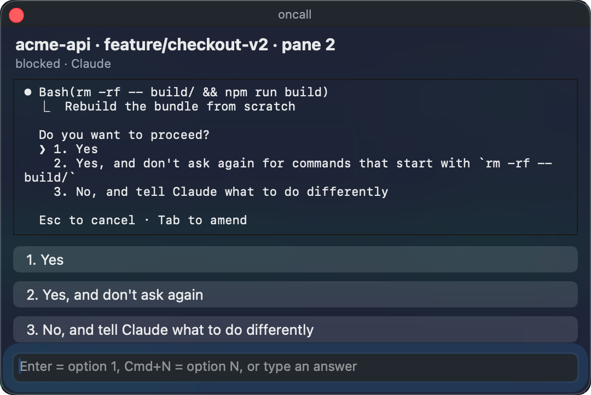

# Oncall

**Your coding agent hit a permission prompt. You're in another app, on another desktop, or out for coffee. Oncall gets you back in the loop — and lets you answer without going back.**

A [Herdr](https://herdr.dev) plugin that watches your agent panes and, the moment one blocks on a prompt or finishes a turn, puts it in front of you: a floating panel on your Mac with one button per option, or a Telegram or Feishu message when you're away from the desk. Either way, your answer goes straight back into the pane.



Works with [Claude Code](https://claude.ai/code), OpenAI Codex, and any agent whose prompts Herdr can see.

**Contents:** [Install](#install) · [Phone channels](#phone-channels) · [Day to day](#day-to-day) · [More than one Herdr session](#more-than-one-herdr-session) · [With drover](#with-drover) · [Troubleshooting](#troubleshooting) · [Config](#config)

## What you get

- **It names the task.** `acme-api · feature/checkout-v2 · pane 2`, not "an agent needs attention".
- **You answer from where you are.** On the Mac, a panel with one button per option and a field for a typed answer. On the phone, the same buttons, or a reply.
- **It does not take your keyboard.** No panel takes the keyboard as it appears. What you are typing elsewhere stays there until you click the panel.
- **A finished turn does not interrupt you.** A done panel only shows the agent's last answer, and goes behind your window at the next click.
- **It reaches your phone when the desk does not answer.** A question nobody answers within `BLOCKED_DELAY_SEC` (60 s) goes to Telegram or Feishu.
- **It stays quiet when it should.** No panel opens while you are looking at that pane, and an open one closes when you answer in the terminal.

## Install

Requirements:

- **Herdr** 0.7.0 or later, on macOS or Linux.
- **Node.js** 18 or later; 22 or later to receive Feishu replies. No npm dependencies.
- **The panel is macOS-only** and is compiled at install with `swiftc`, from Xcode Command Line Tools (`xcode-select --install`). Without it the panel is skipped and the phone channels still work.
- `qrencode`, for the QR codes that pairing prints in the log, is installed for you (Homebrew on macOS; your package manager on Linux, which needs root or passwordless `sudo`). If that fails the install carries on, and `pair` prints its link without a QR code.

```sh
herdr plugin install fulanto/herdr-oncall --ref stable --yes
```

No Herdr restart is needed. `--ref stable` makes the install follow releases (see [Updates](#updates)).

On a Mac that is all the setup there is: blocked and done open the panel, with no phone channel configured. Check it:

```sh
herdr plugin action invoke test --plugin com.codreamer.herdr.oncall
herdr plugin log list --plugin com.codreamer.herdr.oncall --limit 5
```

`plugin action invoke` only starts the action; what it printed is in `plugin log list`. With no phone channel paired, `test` opens a test panel (`no remote channel paired; opening a test panel`).

Two things to know:

- **Codex.** Pings carry the agent's own words, read from its session record. Claude Code needs nothing for that. For Codex, Oncall installs Herdr's Codex integration (`INSTALL_AGENT_INTEGRATION=0` turns that off): Codex asks once to trust the new hook, and sessions already running need a restart. Until then their done pings are read off the screen.
- **Your settings survive.** They live in `.env` in the plugin's config dir (`herdr plugin config-dir com.codreamer.herdr.oncall` prints it), which reinstalls, updates and uninstalls leave alone.

## Phone channels

Optional, for when you are away from the desk. Pair Feishu, Telegram, or both. `CHANNEL` in `.env` says where pings go (`telegram`, `feishu`, or `telegram,feishu`); replies are taken from every paired channel.

### Feishu

```sh
herdr plugin action invoke pair-feishu --plugin com.codreamer.herdr.oncall
```

1. On a Mac a panel with a QR code opens. Elsewhere the code and its link are in the plugin log.
2. Scan it with the Feishu (or Lark) app and approve. That one scan creates your Oncall bot, and whoever scanned is the only Feishu user it takes answers from.
3. The bot messages you `paired · this machine will send oncall here`. `.env` now has `FEISHU_APP_ID`, `FEISHU_APP_SECRET`, `FEISHU_OPEN_ID`, `FEISHU_DOMAIN`, and `CHANNEL=feishu` (a `CHANNEL` that already lists feishu is kept).

Receiving replies needs Node 22 or later, since Feishu delivers them over a WebSocket.

**Pair once.** Every scan creates another bot in Feishu, and pairing survives reinstalls and updates. So `pair-feishu` on a machine that is already paired scans nothing:

- Feishu confirms the saved bot: nothing is created, and the bot messages you `already paired · this machine sends oncall here`.
- Feishu says the saved bot is disabled or its secret is wrong: the scan goes ahead and makes a new bot.
- Feishu cannot confirm it for any other reason (offline, an access policy, a rate limit): nothing is created. Try again later.

**To start over with a new bot**, unpair first:

```sh
herdr plugin action invoke unpair-feishu --plugin com.codreamer.herdr.oncall
```

It messages the old bot `unpaired · this machine no longer sends oncall here`, empties the `FEISHU_*` keys, takes `feishu` out of `CHANNEL` (back to `telegram` if it was the only one), and withdraws a scan still in progress. The old bot stays in Feishu until you delete it on the Feishu open platform.

### Telegram

1. Get a bot token from [@BotFather](https://t.me/BotFather) and put `TELEGRAM_BOT_TOKEN=…` in `.env`. Leave `TELEGRAM_CHAT_ID` empty. No restart is needed: the poller rereads `.env`.
2. Start the pairing:

   ```sh
   herdr plugin action invoke pair --plugin com.codreamer.herdr.oncall
   ```

3. Open the `https://t.me/…?start=…` link from the plugin log, or scan the QR code printed there, within 10 minutes. The bot answers `paired · this machine will send oncall here` and the poller writes `TELEGRAM_CHAT_ID` for you. Only that chat can drive your panes.

Pings go to Telegram while `CHANNEL` lists it. Pairing Feishu sets `CHANNEL=feishu`, so write `telegram,feishu` to get both.

With drover, a paired Telegram chat works like the Feishu chat described in [With drover](#with-drover): messages to the main session are prefixed `[Telegram] `, and whoever gets into the chat can drive the main session too.

### Check a channel

Run `test` again (the command under [Install](#install)). It sends a test ping to every paired channel in `CHANNEL` and logs `sent test ping · <channel>`. The ping arriving is the check.

The test ping belongs to no pane, so do not answer it: a reply goes to the pane of your latest real ping, or is answered `Reply to a ping so I know which pane.` when there is none. To try replies, answer a real blocked or done ping.

If Oncall is toggled off, `test` still sends its ping, and says first `oncall: off, blocked and done send nothing until it is turned back on: …`.

## Day to day

### At the desk: the panel

**A question (blocked).** The panel opens in the top-right corner of the screen your pointer is on, above other windows and on every Space. Its heading is the location, with `blocked · Claude` under it, then the dialog, one button per option, and a text field.

| you do | what happens |
|---|---|
| click a button | that option is sent to the pane |
| click anywhere else on the panel | the panel takes the keyboard: Enter in the empty field picks option 1, Cmd+1 to Cmd+9 pick that option, typed text plus Enter goes in as your answer |
| press Esc (after that click), or close the panel | the question goes to your phone at once |
| nothing, for `BLOCKED_DELAY_SEC` | the panel closes and the question goes to your phone |
| answer in the terminal | the panel closes itself and nothing goes to the phone |

No panel opens while you are at that pane (it is Herdr's focused pane and your terminal is the frontmost app), and an open one closes when you get there. The question still goes to the phone after `BLOCKED_DELAY_SEC` if it is unanswered then. If your terminal is not recognised as one, add its bundle id to `DESKTOP_PANEL_TERMINALS`.

A form with several questions is followed: after each answer the panel shows the next question.

**A finished turn (done).** The panel shows the agent's last answer and nothing else: no field, not kept on top, never the keyboard. It closes with its close button, or after `DESKTOP_PANEL_TIMEOUT_SEC`. With a phone channel paired, the done ping also goes to the phone, right away. `NOTIFY_ON=blocked` turns done notifications off.

**Without the panel** (Linux, `DESKTOP_PANEL=0`, or no `swiftc` at install), a question waits `BLOCKED_DELAY_SEC` and then goes to the phone if it is still on screen.

### From the phone

A blocked ping carries the dialog and one button per option: a card in Feishu, a message with buttons in Telegram. A done ping carries the agent's last answer.

| you do | where it goes |
|---|---|
| tap a button | the dialog that ping was about |
| reply to a ping (quote it) | that ping's pane |
| send a plain message | the pane of your latest ping (with drover: the main session) |

What your text does depends on the pane at that moment. If a dialog is waiting, the text answers it: a single letter or digit, or a key name (`esc`, `enter`, `tab`, `space`, `up`, `down`, `left`, `right`), is pressed as that key, and anything else is typed in and submitted. Otherwise the text goes in as a new prompt.

The answer comes back as `sent · <where>`, or as `failed · <where>` with Herdr's error. A ping can be answered for 24 hours.

**A late tap presses nothing wrong.** Before a button or a quoted reply reaches a dialog, Oncall checks that the dialog on screen is still the one the ping was about.

- A different dialog is up: nothing is pressed. You get `弹框变了，没按 · <where>` and `已换成下面这张新卡片`, with a new card for the dialog now on screen (or `现在的弹框已经有一张卡片了，请点那一张` when that dialog already has a card).
- The dialog is gone: `这个确认已经处理过了 · <where>`.

A form with several questions is followed here too: answer one, and the next arrives as its own ping.

Without drover the chat has one command, `/help` (also `/start`), answered `Blocked: tap a choice or type one. Done: send a new instruction.` Anything else that starts with `/` is ignored, never typed into a pane. A message with no ping to go by is answered `Reply to a ping so I know which pane.`

### What a Feishu message can carry

- **Text and rich text** (words and pictures together). Rich text goes in line by line: links as `text (url)`, mentions as `@name`, code blocks fenced.
- **Pictures.** Each one is saved to `CHAT_IMAGE_DIR` (default: `chat-images` in the state dir) and goes in as a line of its own, `[图片] <path>`, where it stood in the message. The agent opens the file itself, and may ask first when its rules do not allow that folder. Oncall deletes the pictures it saved after 7 days.
- **A picture that could not be fetched** (Feishu refused it, the network, over 30 MB) goes in as `[图片 没拿到：<reason>]`, and the reply says `第 N 张图片没拿到：<reason>`. When nothing is left to send, nothing is typed and the reply starts `没送进去：`.
- **A picture never answers a dialog.** A message with one, sent where a dialog is waiting, is not typed at all: `确认框只能用文字或按钮回答，这条带图片，没送 · <where>`. The card stays usable.
- **Everything else** (files, audio, video, stickers, forwarded chats, cards) does not go in: `暂不支持<what>，没送进去`. A video inside rich text is marked `[视频 没送：暂不支持]` and the rest goes in.

### Turning it off and on

```sh
herdr plugin action invoke toggle --plugin com.codreamer.herdr.oncall
```

`enable` and `disable` set it outright. While off, blocked and done send nothing, the panel included, and `test` still works.

### Actions

Every action runs as `herdr plugin action invoke <id> --plugin com.codreamer.herdr.oncall`, and its output is in `herdr plugin log list --plugin com.codreamer.herdr.oncall --limit 5`.

| id | does |
|---|---|
| `test` | a test ping, or a test panel when no phone channel is paired |
| `toggle`, `enable`, `disable` | the on/off switch |
| `pair-feishu`, `unpair-feishu` | pair the Feishu bot, or forget it |
| `pair` | pair the Telegram chat |
| `status` | one line of JSON: version, switch, channels, owner session, poller, panel |
| `poll` | "Restart reply poller". Run in another Herdr session, it moves Oncall there |
| `setup` | seeds the config and prints the setup hints |

## More than one Herdr session

Skip this if you run one Herdr.

With more servers (`herdr --session <name>`), Herdr runs every plugin in each of them, but a machine has one Oncall: one bot, one process receiving replies, one state directory. A pane id such as `w1:p1` exists in every server. So **Oncall belongs to one Herdr session at a time**, and only that session's panes are pinged and answered.

**See who has it:**

```sh
herdr plugin action invoke status --plugin com.codreamer.herdr.oncall
herdr plugin log list --plugin com.codreamer.herdr.oncall --limit 5
```

In the JSON line, `session.socket_path` is the Herdr you ran it in and `owner.socket_path` the one Oncall belongs to. `owner.running` says whether a server is listening there, `owner.current_session` whether that is this one, and `poller.bound_to_owner` whether the reply poller is on it. `status` runs in any session and changes nothing.

**Move it** by running Restart reply poller (`poll`) in the session that should have it:

```sh
herdr plugin action invoke poll --plugin com.codreamer.herdr.oncall
```

The log says `oncall moved · <old socket> → <new socket> · …`, then `poller pid <n> · herdr <socket>`. A move that did not work ends `poll failed · …` with exit 1: run it again.

After a move, pings sent from the old session can no longer be answered from the phone (their pane ids are other panes here). Messages queued for drover's main session are kept. Where Oncall already is, `poll` only restarts the poller.

**How the first owner is decided.** With no owner on record, the first session in which Oncall does anything gets it: its server starting, an agent changing status, an action other than `status`. The log says `oncall claimed · <socket> · …`. An install does not claim it, since Herdr runs the build outside any session.

**In every other session** Oncall does nothing:

| there | result |
|---|---|
| the server starts | `skipped · startup · this herdr session (…) does not own Oncall, … does; to move it here: …` |
| a pane goes blocked or done | `not sent · <status> · <pane> · this herdr session (…) does not own Oncall, …`; no ping, no panel |
| a pane goes working or idle | nothing, not even a log line |
| `toggle`, `enable`, `disable`, `test`, `pair`, `pair-feishu`, `unpair-feishu` | `refused · <action> · this herdr session (…) does not own Oncall, …`, exit 1 |
| `status` | answers |
| `setup` | seeds the config; the poller is left alone |

**When the owner's Herdr is not running, nobody takes over.** Oncall waits for it; another session that happens to be up does not inherit your phone. What you see meanwhile:

- With drover, a Feishu message for the main session is answered `没送进去：herdr 连不上（<socket>）：<why>。Oncall 归属的这个 herdr 没在运行；它起来以后再发一次，或者在你现在用的 herdr 里跑一次 Restart reply poller（herdr plugin action invoke poll --plugin com.codreamer.herdr.oncall）把 Oncall 切过去`. A message that was already queued is kept, and goes in when that Herdr is back.
- Without drover, a reply or a tap is answered `failed · <where>` with Herdr's error.
- Pings from the session you are actually using do not arrive. Its log has the `not sent` line from the table above.

Either start that Herdr again, or run `poll` in the session you use.

**After upgrading** from a version that kept no owner, an update that installed itself gives Oncall to the session its poller was already serving. If you run more than one session, run `poll` once in the one you use. Oncall stays there until you run it somewhere else.

## With drover

drover runs a main session that you talk to, orchestrators it starts (`orch-*`), and workers they start. Each layer approves the dialogs of the one below, so only the main session's dialogs are yours. Without drover, nothing in this section applies.

**Setup.** drover's installer installs Oncall and configures it by writing `drover.env` next to your `.env`, which it leaves alone. The one step left to you is pairing Feishu: `~/.drover/bin/drover oncall pair`, which runs the `pair-feishu` action (see [Feishu](#feishu)).

**Who is who** comes from the agent's name in Herdr:

| name | role | blocked | done |
|---|---|---|---|
| `MAIN_AGENT_NAME` (`drover`) | the main session | panel, then phone after `BLOCKED_DELAY_SEC`; headed `主会话在等你确认`, with no location line | see below |
| starts with `SUPERVISOR_PREFIX` (`orch-`) | orchestrator | no panel, no ping; you are pinged only if the same dialog still waits after `SUPERVISOR_ESCALATE_SEC` (5 min), or `SUPERVISOR_ESCALATE_SEC_CODEX` (2 min) when the main session runs Codex | not pinged: the main session relays it |
| any other name | worker | the same, after `SUPERVISED_ESCALATE_SEC` (10 min) | not pinged: its orchestrator relays it |
| no name | a pane you opened | as without drover | as without drover |

**Escalations.** `升级 · worker <name> 卡在确认框 10 分钟` says who is stuck and for how long, then where, who normally answers, and the dialog with its buttons.

- It goes out once per dialog. A different dialog starts the clock over, and one that leaves the screen is forgotten.
- With no phone channel paired, it opens the panel instead.
- A dialog only counts while Herdr does not report the pane as `working`, since an agent can print dialog text of its own.

**What the main session's done sends.** With `MAIN_DONE_PING=relay` (drover's setting; the default `always` pings every turn), only:

- the answer to a chat message you sent it, as a reply under that message. The turn is found in the agent's session record by your message, so a turn started by some other event is not taken for it;
- a relay: a turn whose closing answer starts with `MAIN_RELAY_MARKER` (`【转达】`);
- a turn cut short by an API error: `主会话这一轮被接口错误打断了，回复「继续」让它接着做`.

Everything else is quiet, and the done panel on the Mac opens as before. These pings carry only the main session's words: no title, no location line.

**The chat is a line to the main session** (`BARE_MESSAGE_TARGET=main`). A message that quotes no ping goes to the main session, found by name each time. Quoting a ping or tapping a button still answers that ping's pane.

What goes in is prefixed `[飞书] `, stripped of control characters, and cut at 2000 characters of words. The terminal reads its input box as keys: without the prefix, a leading `!` would run a shell command and a leading `/` a slash command.

Pictures go in as their `[图片] <path>` lines and are never cut. drover sets `CHAT_IMAGE_DIR=~/.drover/oncall-images`, which the main session may read without asking.

The reply says what became of your message:

| the main session | your message | reply |
|---|---|---|
| is idle | goes in | `已送达主会话` |
| is working, on Claude Code | goes in; Claude Code takes it next | `已送达，主会话正在处理上一件事，会接着看` |
| has a dialog or a question up | waits until that is answered | `主会话在等确认：<question>。先回那条确认通知；你这条已暂存，确认完自动送` |
| has unsent text in its input box | waits; `/send` clears the box and sends | `终端输入框里有没发出的内容「…」，你这条已暂存。回 /send 清空草稿后送入，或者回到电脑处理` |
| is mid-turn on Codex | waits until Codex stops | `主会话正在处理上一件事（Codex 收到新消息会打断当前这一轮），你这条已暂存，它停下就送` |
| has no name for a moment (restarting) | waits up to 30 seconds, then is dropped | `没找到主会话（herdr 里名为 <name> 的 agent），在主会话里跑 drover main-register` |
| already has messages waiting | waits its turn | `你这条已暂存，排在前面 N 条后面，主会话能接收时按顺序送` |
| cannot be reached, because no Herdr is listening | is turned away at once | `没送进去：herdr 连不上（<socket>）：…` (see [More than one Herdr session](#more-than-one-herdr-session)) |

A waiting message goes in by itself, in order, as soon as the main session can take it. One still waiting after 30 minutes is mentioned once (`还没送进去：「…」（…），仍在暂存`) and kept. A dialog the main session raises while one of your messages still waits for its answer is pinged at once, without the panel's wait.

**Chat commands** are handled by Oncall and never typed into a pane:

- `/help` says what goes where.
- `/off` and `/on` are the same switch as the `toggle` action. While off, nothing from the chat reaches a pane, buttons included.
- `/send` clears the unsent text in the main session's input box, quotes it back, and sends the waiting messages.

Any other `/command` is answered `不认识的命令 …，发 /help 看说明`.

**Anyone who gets into the paired Feishu account can drive the main session like you can**, including pushing code: nothing from the chat asks for extra confirmation. `/off` only stops Oncall from bothering you, since whoever can send `/off` can send `/on`. Unpair (`unpair-feishu`) if the account is lost.

**Not covered:** while the main session waits for a background subagent, Herdr reports the subagent's dialog as `working`, so no blocked event arrives for it. drover's own watcher reads the screen for that case.

**drover's task board** sends what you click there to the main session as `[看板] <text>`, by the same rules as a chat message, and is not held by `/off`. How drover's code calls Oncall is written down in `CLAUDE.md`.

## Troubleshooting

Every blocked or done event leaves a line in the plugin log saying what became of it:

```sh
herdr plugin log list --plugin com.codreamer.herdr.oncall --limit 20
```

**The test ping arrives, a real one does not.** Usually that is by design: on a Mac a blocked prompt goes to the panel first, and to the phone only if nobody answers within `BLOCKED_DELAY_SEC`. Answer on the panel or in the terminal and no phone ping goes out, while `test` sends straight away.

Otherwise find the event's line below. No line at all for a blocked prompt means Herdr never reported the pane as blocked: check `herdr pane list` while the prompt is up.

### What the log lines mean

`<where>` is the location (`acme-api · feature/checkout-v2 · pane 2`), `<pane>` a pane id.

Sent or answered:

| line | meaning |
|---|---|
| `sent · <channel> · <where>` | the ping went out on that channel |
| `<channel> ping failed · <where>: …` | the channel refused it or could not be reached |
| `panel sent · <where>` | answered on the panel (`panel delivery failed · <where>: …` when Herdr refused the answer) |

Not sent, on purpose:

| line | meaning |
|---|---|
| `not sent · <where> · the dialog left the screen during the wait (answered)` | answered before the delay ran out |
| `not sent · <where> · pane screen empty after the wait` | the pane read back blank after the delay |
| `not sent · <where> · a newer blocked event for this pane took over` | a later event for the same pane owns the ping (`a newer event for this pane took the panel over` while the panel was up) |
| `not sent · <where> · already pinged for this call` | Herdr reported the same unanswered dialog again, and its card can still be tapped (`a panel for this call is already open` when it is the panel) |
| `not sent · <where> · no paired phone channel in CHANNEL=…` | `CHANNEL` names no paired channel |
| `panel closed · <where> · …` | the panel closed with no answer from it: `moved-on` (answered in the terminal), `at-pane` (you got to the pane), `nothing left to answer` |
| `panel skipped · <where> · pane is on screen` | you were already at the pane |
| `panel not sent · <where> · …` | a click was not pressed: `the dialog changed` or `the dialog was already answered` |
| `debounced · <where> · …` | the same pane and status again within `DEBOUNCE_MS`, or an event for a question already being handled |
| `off · <status> · <pane> · oncall is off (toggled), nothing is sent; turn it back on: …` | Oncall is toggled off |
| `ignored · <pane> · <status> is not in NOTIFY_ON=…` | `NOTIFY_ON` leaves that status out |
| `no remote channel paired (telegram or feishu) and no desktop panel` | there is nowhere to send anything |

Herdr and the screen disagree:

| line | meaning |
|---|---|
| `skipped · <where> · blocked but no dialog on screen · tail: …` | Herdr said blocked and no prompt was recognised; the screen is saved to `last-skipped-screen.txt` (`blocked but pane screen empty` when the pane read back blank) |
| `menu on screen · <where> · herdr said done` | Herdr said done with a menu still open; handled as a question |
| `hook-authoritative · <where>` | an agent whose integration reports its own status; trusted with no menu on screen |

Another Herdr session (see [More than one Herdr session](#more-than-one-herdr-session)):

| line | meaning |
|---|---|
| `not sent · <status> · <pane> · this herdr session (…) does not own Oncall, … does; to move it here: …` | the event came from a session Oncall does not belong to. With `<where>` in place of the status and pane: Oncall moved while the event was waiting |
| `not recorded · <where> · oncall moved to another herdr session while this ping was on its way` | the ping went out, but cannot be answered from the phone |
| `oncall claimed · <socket> · …` / `oncall moved · <old socket> → <new socket> · …` | a session became the owner, by being first or through `poll` |
| `poller started · pid <n> · herdr <socket> · …` | the poller was missing or on the wrong Herdr, and was started again: `none was running`, `the one running had no herdr on record`, `the one running was bound to <socket>` |

With drover:

| line | meaning |
|---|---|
| `quiet · worker · <name> · <where> · done (supervised)` | a worker's turn ended (`supervisor` for an orchestrator); the layer above relays it |
| `escalation armed · worker · <name> · <where> · pings after 600s if nobody answers` | a dialog the layer above should answer; you are pinged if it is still there then (`escalation kept · …` when Herdr reports it again) |
| `quiet · main · <where> · done (not a chat answer or relay)` | with `MAIN_DONE_PING=relay`: the main session's turn was neither |
| `chat answer · <where> · …` | what became of a chat message still waiting for its answer |

### The poller's log

`poller.log` in the state dir (`~/.local/state/herdr/plugins/com.codreamer.herdr.oncall/`) is the log of the process that receives replies. Every line has a time, and the file is rotated once at 256 KB.

| line | meaning |
|---|---|
| `oncall poller stopping pid=… · …` | it stood down: Oncall belongs to another session now, or another poller is on record |
| `idle · no TELEGRAM_BOT_TOKEN in .env` / `idle · TELEGRAM_POLL is off` | why Telegram replies are not read. A line containing `Conflict` means something else is reading the same bot token |
| `feishu idle · not paired (pair-feishu)` / `feishu idle · replies need Node 22 or later, this is …` | why Feishu replies are not read |
| `escalated · worker · <name> · <where> · after 10 分钟` | with drover: an escalation went out. `escalation cleared · … · dialog gone` and `escalation reset · … · a different dialog is up, counting from now` say what became of the others |
| `main inbox · delivered\|stashed\|refused · <n> chars · …` | with drover: what became of a message for the main session, never its text |

### A ping that reads wrong

Dialog shapes differ between agents and versions. The screen a ping was read from is usually already saved in the state dir: `last-blocked-screen.txt`, `last-done-screen.txt`, or `last-skipped-screen.txt` for a prompt that was skipped.

Open an issue with that file; the test fixtures are made of exactly these. While a dialog is still up, `herdr pane read <pane> --source visible --format text` captures it too.

### Setup problems

- `node not found for Herdr. …` in the plugin log: start Herdr from a terminal where `command -v node` works.
- `panel: not built, needs Xcode Command Line Tools (xcode-select --install), then reinstall the plugin` in the install output: do that.
- Replies do nothing: look in `poller.log` for one of the `idle` lines above.

## Updates

Releases install themselves. When the poller starts, and every 6 hours after that, Oncall asks Herdr to update it from the `stable` branch, which moves only when a version is released. Herdr builds the new version beside the old one, and your paired chat gets `oncall updated · v… → v…` with a link to the release.

- An install made without `--ref stable` is moved onto it at the first check.
- A checkout linked with `install.sh` is never touched.
- `AUTO_UPDATE=0` turns it off. `herdr plugin update com.codreamer.herdr.oncall --yes` updates by hand.
- If you run more than one Herdr session, see the note on upgrading in [More than one Herdr session](#more-than-one-herdr-session).

## Config

Settings are `KEY=value` lines in `.env` in the config dir (`herdr plugin config-dir com.codreamer.herdr.oncall` prints it). Edits need no restart.

| key | default | meaning |
|---|---|---|
| `NOTIFY_ON` | `blocked,done` | which statuses notify |
| `BLOCKED_DELAY_SEC` | `60` | how long a question waits, on the panel where there is one, before the phone is pinged. `0` = ping immediately |
| `DEBOUNCE_MS` | `2000` | drop a repeat of the same pane and status inside this window |
| `CHANNEL` | `telegram` | where pings go: `telegram`, `feishu`, or `telegram,feishu`. Replies are taken from every paired channel. `pair-feishu` sets it to feishu, `unpair-feishu` takes feishu out |
| `HERDR_TELEGRAM_ENABLED` | `1` | whether Oncall starts switched on. Only read until the switch is first used |
| `HERDR_TELEGRAM_SET_TITLE` | `1` | `toggle` sets the host terminal's title while Oncall is on |
| `HERDR_TELEGRAM_TITLE` | `oncall` | that title |
| `AUTO_UPDATE` | `1` | install each release automatically. `0` = by hand only |
| `INSTALL_AGENT_INTEGRATION` | `1` | install Herdr's Codex integration, so Codex pings carry Codex's own words. `0` = never touch agent configs |

The panel:

| key | default | meaning |
|---|---|---|
| `DESKTOP_PANEL` | `1` | the macOS panel. `0` = phone only |
| `DESKTOP_PANEL_TIMEOUT_SEC` | empty | how long a done panel stays open, and a blocked one when `BLOCKED_DELAY_SEC=0`. Empty = `BLOCKED_DELAY_SEC`, or 60 when that is 0. Otherwise a blocked panel stays for `BLOCKED_DELAY_SEC` |
| `DESKTOP_PANEL_TERMINALS` | empty | extra terminal bundle ids, comma-separated, that count as "you are at the pane" |
| `DESKTOP_PANEL_DEBUG` | empty | `1` logs the screen and window rect the panel was placed on, and its focus state when it opens and when it is clicked |

Feishu and Telegram:

| key | default | meaning |
|---|---|---|
| `FEISHU_APP_ID` / `FEISHU_APP_SECRET` | set by `pair-feishu` | the bot the scan created. Emptied by `unpair-feishu` |
| `FEISHU_OPEN_ID` | set by `pair-feishu` | the only Feishu user allowed to drive your panes |
| `FEISHU_DOMAIN` | set by `pair-feishu` | `feishu` or `lark` |
| `CHAT_IMAGE_DIR` | `chat-images` in the state dir | where pictures sent from Feishu are saved. An absolute path; a leading `~` is your home. drover sets it to `~/.drover/oncall-images` |
| `TELEGRAM_BOT_TOKEN` | empty | the BotFather token |
| `TELEGRAM_CHAT_ID` | set by `pair` | the only chat allowed to drive your panes |
| `TELEGRAM_POLL` | `1` | `0` = do not read replies from Telegram. Pings still go out; replies and pairing stop |

drover's keys are written to `drover.env` by drover's installer (see [With drover](#with-drover)). That file is read last, so a value you put in `.env` wins over drover's, except an empty one, which does not count as set. Leave them out of `.env` unless you mean to override drover.

| key | default | meaning |
|---|---|---|
| `MAIN_AGENT_NAME` | empty | the main session's agent name in Herdr (`drover`). Empty = no roles: every pane as without drover |
| `SUPERVISOR_PREFIX` | `orch-` | agents named with this prefix are orchestrators |
| `SUPERVISOR_ESCALATE_SEC` | `300` | how long an orchestrator's dialog may wait before you are pinged |
| `SUPERVISOR_ESCALATE_SEC_CODEX` | `120` | the same, when the main session runs Codex |
| `SUPERVISED_ESCALATE_SEC` | `600` | how long a worker's dialog may wait before you are pinged |
| `BARE_MESSAGE_TARGET` | `last` | where a chat message that quotes no ping goes: `last` = the pane of the latest ping, `main` = the main session |
| `MAIN_DONE_PING` | `always` | what the main session's done sends: `always` = every turn, `relay` = only chat answers, relays and API errors |
| `MAIN_RELAY_MARKER` | `【转达】` | the opening that makes a main-session turn a relay |

## How it decides

Most of the work is in not sending a notification.

- **It reads the screen, not the status flag.** Herdr marks a pane blocked when dialog wording appears anywhere in its recent output, so an agent that merely prints a permission prompt looks blocked. Oncall requires a live dialog, with nothing below it but key hints and status footers.
- **It reads the pane, not your display.** Reads go through Herdr, so the window can be minimised or on another Space.
- **It parses the dialog by its structure.** Options are the numbered run at the bottom of the screen, and the body is bounded by the UI's own markers, never by a "last N lines" guess.
- **It reads what the agent wrote and presses what the screen shows.** The command or question comes whole from the agent's session record. The choices, the keys, and the check that the dialog is still the same come from the screen.
- **It never sends the transcript.** Blocked sends the tool call and the dialog, done the agent's last answer.
- **Only you can drive your panes.** Messages and taps from anyone but the paired `TELEGRAM_CHAT_ID` or `FEISHU_OPEN_ID` are dropped.

What it will not do:

- Ship a phone app. Telegram and Feishu are the remote channels; a thin app would talk to this same plugin.
- Show a system notification banner with buttons. macOS only allows that for a signed app bundle, so the panel is a plain floating window instead.

## Development

```sh
node --test 'test/*.test.mjs'        # node's built-in runner
bash install.sh                      # link this checkout into Herdr
bash bin/install-deps.sh             # rebuild the panel after editing panel.swift
```

```text
herdr-plugin.toml     manifest: actions, event hooks, build steps
bin/                  node locator, dependency install, compiled panel
src/desktop/          panel.swift, the macOS floating panel
src/lib/              screen parsing, Herdr calls, config, ownership, Telegram, Feishu
src/hooks/            notify (the event hook) and poll (the poller)
src/inbound/          replies and delivery into the pane, escalations, the main-session inbox
src/actions/          setup, seed, poll, pair, pair-feishu, unpair-feishu, test, toggle, status, send-main
test/
```

`CLAUDE.md` has the architecture and the reasons behind it. A release is a bump of `version` in `herdr-plugin.toml` pushed to `main`: once the tests pass, CI publishes the release and moves `stable` to it.

Derived from [`ogulcancelik/herdr-plugin-examples/agent-telegram-notify`](https://github.com/ogulcancelik/herdr-plugin-examples/tree/main/agent-telegram-notify).

## License

MIT © 2026 fulanto. See [LICENSE](LICENSE).
